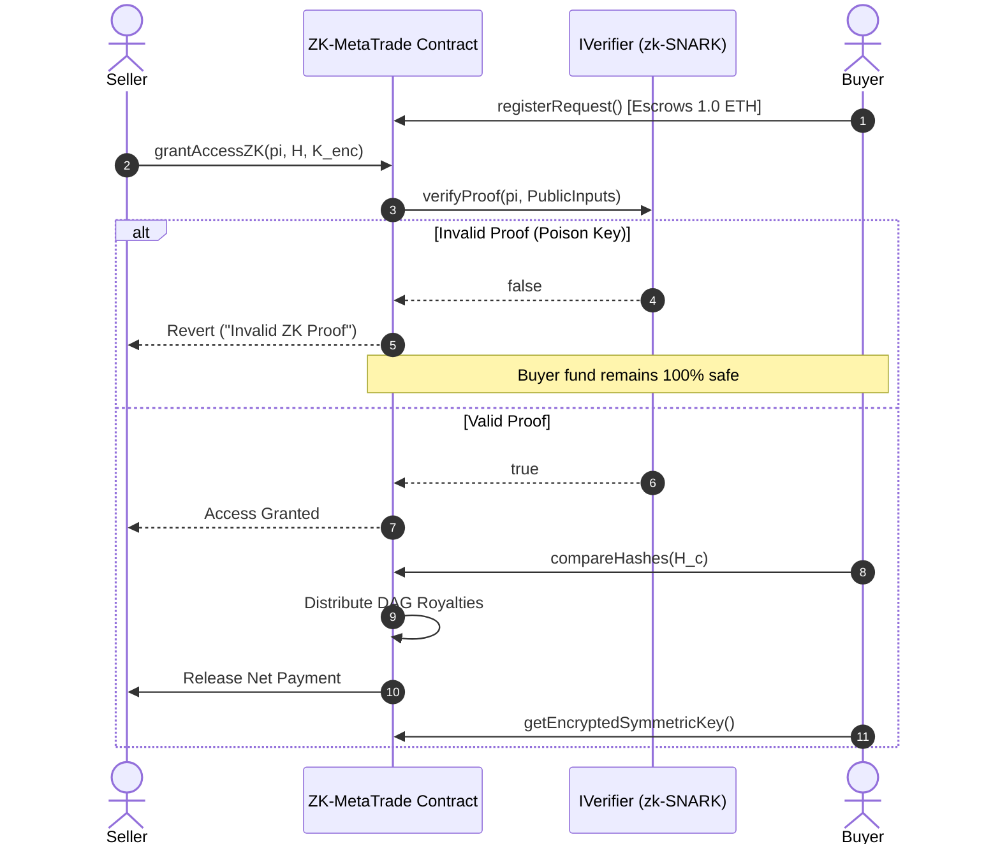

# VS Code Figures & Visualization Setup Guide

এই গাইডে দেখানো হয়েছে কীভাবে VS Code-এর ভেতরে রিসার্চ পেপার ও থিসিসের সমস্ত ফিগার (ডায়াগ্রাম, চার্ট, সিকোয়েন্স) দেখা, এডিট করা এবং নতুন ফিগার তৈরি করা সম্ভব।

---

## ১. তৈরি করা ফিগারসমূহ (`figures/` ফোল্ডারে আছে)

আমরা ইতিমধ্যে পাবলিকেশন কোয়ালিটির **300 DPI PNG** এবং ভেক্টর ফরম্যাটের **SVG** ফাইল তৈরি করে রেখেছি:

| ফিগার ফাইল | বিষয়বস্তু (Description) |
| :--- | :--- |
| **`fig1_system_architecture.png` / `.svg`** | ZK-MetaTrade এর সম্পূর্ণ হাই-লেভেল আর্কিটেকচার (Seller, Buyer, IPFS, Smart Contracts, DAG)। |
| **`fig2_poison_key_vs_zk_defense.png` / `.svg`** | MetaTrade-এর Poison Key Attack বনাম ZK-MetaTrade-এর ZK-Defensive Shield পাশাপাশি তুলনা। |
| **`fig3_multi_parent_dag_royalties.png` / `.svg`** | জেনারেটিভ এআই পাইপলাইনের মাল্টি-প্যারেন্ট রয়্যালটি স্প্লিট DAG (SDXL 10%, LoRA 10%, ControlNet 5%, Creator 75%)। |
| **`fig4_gas_benchmarks.png` / `.svg`** | MetaTrade IEEE 2024 বনাম ZK-MetaTrade-এর প্রতিটি মেথডের অন-চেইন গ্যাস খরচ তুলনা চার্ট। |

---

## ২. VS Code-এ ফিগার সেটআপ ও এডিটিংয়ের সেরা এক্সটেনশনসমূহ

VS Code-এ ফিগার সরাসরি লাইভ দেখা এবং এডিট করার জন্য নিচের ৩টি ফ্রি এক্সটেনশন ব্যবহার করা যায়:

### ক. **Draw.io Integration (হাতে এঁকে ডায়াগ্রাম বানানোর জন্য সেরা)**
* **এক্সটেনশন নাম:** `Draw.io Integration` (Author: Henning Dieterichs)
* **কীভাবে ব্যবহার করবেন:**
  1. VS Code-এ একটি নতুন ফাইল তৈরি করুন যার নাম দিন: `architecture.drawio` বা `architecture.drawio.png`।
  2. ফাইলটি ক্লিক করা মাত্রই VS Code-এর ভেতরে ফুল-ফিচার ড্রয়িং ক্যানভাস (Visio/Draw.io এর মতো) ওপেন হবে।
  3. ড্র করা শেষ হলে সেভ করলেই সরাসরি `.png` বা `.svg` ছবি আকারে সেভ হয়ে যাবে।

### খ. **Markdown Preview Enhanced (Mermaid ও Math লাইভ দেখার জন্য)**
* **এক্সটেনশন নাম:** `Markdown Preview Enhanced` (Author: Yiyi Wang)
* **কীভাবে ব্যবহার করবেন:**
  * যেকোনো `.md` ফাইল ওপেন করে কীবোর্ডে `Ctrl + K, V` বা ডানদিকের Preview বাটনে চাপুন।
  * এর ভেতরে থাকা সমস্ত Mermaid আর্কিটেকচার চার্ট, গণিতের LaTeX সূত্র এবং ছবি লাইভ প্রিভিউ দেখতে পাবেন।

### গ. **LaTeX Workshop (পেপার রাইটিং ও অটোমেটিক ফিগার ইমপোর্ট)**
* **এক্সটেনশন নাম:** `LaTeX Workshop` (Author: James Yu)
* **কীভাবে ব্যবহার করবেন:**
  * আপনার `.tex` ফাইলে ছবি যুক্ত করুন:
    ```latex
    \begin{figure}[htbp]
      \centering
      \includegraphics[width=\linewidth]{figures/fig1_system_architecture.png}
      \caption{High-Level Architecture of ZK-MetaTrade.}
      \label{fig:architecture}
    \end{figure}
    ```

---

## ৩. Mermaid ডায়াগ্রাম সোর্স কোড (VS Code-এ লাইভ দেখতে)

VS Code-এ আপনি নিচের কোডটি যেকোনো `.md` ফাইলে পেস্ট করে সরাসরি লাইভ দেখতে পারেন:

### ক. সিকোয়েন্স ডায়াগ্রাম (Trade Protocol):


---

## ৪. নতুন কোনো ফিগার পরিবর্তন করতে চাইলে:
আপনি সরাসরি `generate_figures.py` স্ক্রিপ্টটিতে মান বা ডিজাইন পরিবর্তন করে টার্মিনালে রান করতে পারেন:
```bash
python generate_figures.py
```
তাহলে সব কয়টি `.png` এবং `.svg` ছবি স্বয়ংক্রিয়ভাবে আপডেট হয়ে যাবে।
